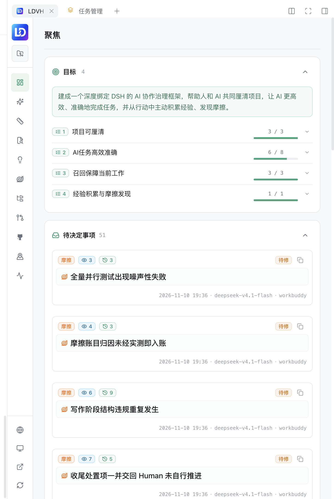
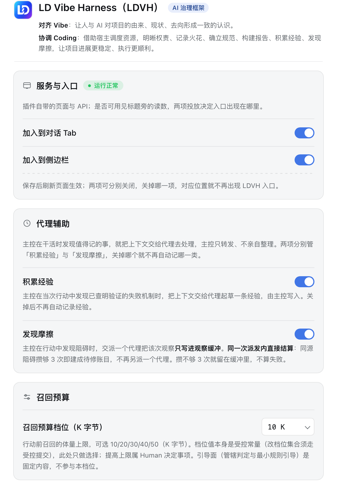
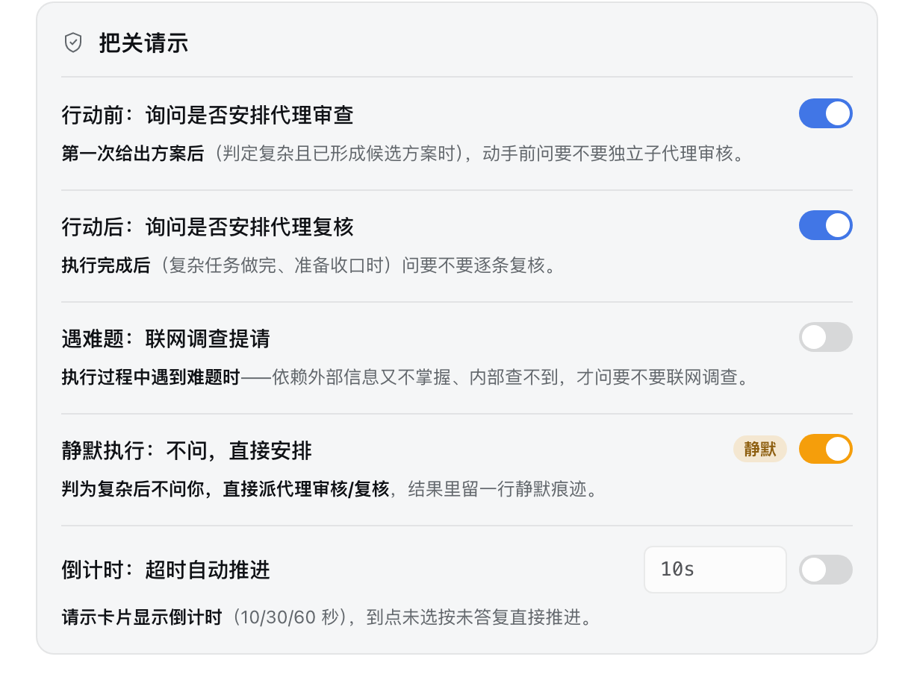
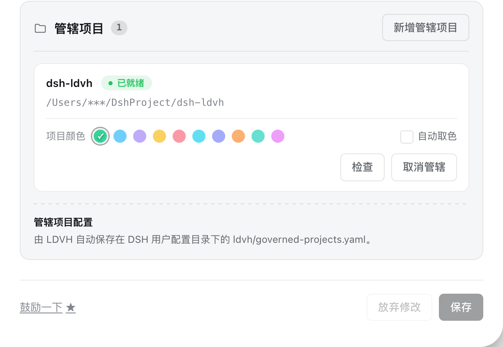

<p align="center">
  
</p>

<p align="center">
  
</p>

<h1 align="center">LDVH · LD Vibe Harness</h1>

<p align="center"><b>一个深度绑定 DSH 的 AI 协作与治理框架，核心价值是对齐 Vibe、协调 Coding。<br>让人与 AI 对项目形成一致认识，让项目进展更稳定、执行更顺利。</b></p>

<p align="center">
  <a href="plugin/README.en.md">English（插件页）</a> ·
  <a href="#截图">截图</a> ·
  <a href="#这是什么">这是什么</a> ·
  <a href="#如何使用">如何使用</a> ·
  <a href="USAGE.md">完整指南</a> ·
  <a href="#快速开始开发">快速开始（开发）</a> ·
  <a href="#版本号双轨">版本</a> ·
  <a href="plugin/CHANGELOG.md">更新日志</a> ·
  <a href="https://github.com/dingminhua/dsh-ldvh/issues">问题反馈</a>
</p>

<p align="center">
  <a href="https://www.npmjs.com/package/dsh-ldvh"></a>
  <a href="https://www.npmjs.com/package/dsh-ldvh"></a>
  <a href="https://github.com/dingminhua/dsh-ldvh/actions/workflows/ci.yml"></a>
  <a href="LICENSE"></a>
  <a href="https://github.com/dingminhua/dsh-ldvh/stargazers"></a>
  <a href="https://dshfind.com/plugins/dingminhua/dsh-ldvh"></a>
</p>

> **开发预览** ｜ 版本 `2.0.3-dev.1` ｜ MIT License（与 DSH 本体同协议）
> 本仓库是 DSH 原生插件 `dsh-ldvh` 的源码仓库：`specs/` 记录 LDVH 要做什么、按什么标准开发（不随插件发布），`plugin-specs/` 是随插件发布的**运行期规则**，`ldvh-base/` 是本项目的事实源。正式版本已发布至 `1.1.6`，当前开发迭代版本为 `2.0.3-dev.1`。

## 截图

### 设置页 · 服务与入口 / 代理辅助 / 召回预算

<p align="center">
  
</p>

### 设置页 · 把关请示

<p align="center">
  
</p>

### 设置页 · 管辖项目（路径已脱敏）

<p align="center">
  
</p>

## 这是什么

LDVH（LD Vibe Harness）以 **DSH 原生插件为统一交付形态**。人与 AI 协作有一组反复出现的困难——AI 的输出靠概率推理、人难以长期维持规划与记忆、双方的不确定会互相放大。LDVH 的机制逐条对着这些困难（Web 帮助页「这是什么」有更详细的展开）：

| 短板 | 典型表现 | 对应机制 |
|---|---|---|
| AI 的输出不稳 | 上下文缺失或过载时容易猜错、采信冲突信息，且难以跨会话保留认识 | 规则随插件给边界、事实源给依据、动作有校验 |
| 人接不住也留不住 | 长期规划越做越模糊，想法与已作的决定随对话散掉 | 每样东西都有可回读的对象，打开看得见、回来接得上 |
| 双方互相放大误差 | AI 不会主动停在困惑处，人难以接住它的笃定、它也猜不准人的含糊 | 该由 Human 决定的必须请示；依据不足时停止而非硬答 |

**核心价值是「对齐 Vibe、协调 Coding」**（`specs/00` §1）：对齐 Vibe 是对**认识**的要求——人与 AI 对项目的由来、现状、去向形成一致；协调 Coding 是对**执行**的要求——借宿主调度把权责、火花、规范、报告、经验、摩擦落到可回读的载体上。

七项业务系统承载业务过程（`specs/00` §2.6）：

| 核心价值 | 承接的业务系统 |
|---|---|
| 对齐 Vibe | 目标规划、火花记录、双源召回 |
| 协调 Coding | 把关请示、调研吸收、经验积累、摩擦销账 |

这些能力通过四种价值交付装进 DSH：**AI 工作引导、LDVH CLI 确定性执行、Web 信息呈现、Git 机械守护**（`specs/00` §2.8）。**AI 该守的规则随插件走**：插件的 `plugin-specs/` 是运行期规则的来源，与项目自己的 `ldvh-base/norms/` 一起构成「什么必须遵守」；判断由事实源锚定（七类事实对象）。每次行动前从规则与事实两处召回，以对话发起的行动由单一主控 AI 最终负责，以主控自查与机械校验为必守底线，代理审核在强制门禁范围内必做、其余按风险与请示结果安排。

**设计要求 ≠ 已落地能力**：以上是机制设计，插件已实现的能力以 [`plugin/README.md`](plugin/README.md) 为准；Web 帮助页（`/ldvh/help`）按对象、系统、入口分章，可作为快速导览；**运行期规则以随插件发布的运行时机制（`plugin-specs/`）为准，事实以事实源为准**；[`specs/`](specs/) 是 LDVH 的开发需求文档，不随插件发布，也不是 AI 在项目里行动的规则来源。

## 如何使用

面向使用者，完整引导见 [LDVH 使用指南](USAGE.md)；运行中的插件另提供 Web 帮助页（`/ldvh/help`），内容更完整且随版本更新；两者不一致时以 Web 帮助页为准。安装与配置见[插件 README](plugin/README.md)。

### 与 AI 配合的主线

LDVH 的核心价值是**对齐 Vibe、协调 Coding**（机制设计见上节「这是什么」）。与 AI 配合有一条主线——不是必须照走的流水线，但每一段都有明确的产物和落点：

1. **目标**——项目要达成什么，被冻结成一个可回指的锚，再拆成带达成条件的子目标。
2. **想法**——值得跨行动推进的事都从火花出生，它也是方向主线的入口。
3. **调研**——围绕还没掌握的问题搜证据，直到不再产生新的确认认识，每条结论都带溯源锚点。
4. **执行**——方案成形、还没动手时问你要不要安排一次审查，收口前再问一次要不要复核。答不答都不拦它推进。
5. **积累**——坑写成经验，系统性阻碍记成摩擦账，方向写成规范，对外调研沉淀成报告。

> **动手之前还有一次双源召回**：从规范源和事实源找回「该守什么、该依据什么、什么事必须停下来问你」。它不留对象，但决定接下来怎么动。

### 怎么开始

**先选定管辖项目，再立起目标。其余一切挂在目标下面。**

**第一步：选定管辖项目**——用 Web 顶部的项目切换器选一个项目。选定之后，页面上的对象、提交记录与检查结论都只属于它。切换器里没有？去那个项目的目录里对 AI 说一句「把这个项目设为 LDVH 管辖」，它会先把项目与路径摆给你确认，确认之后才写进登记，切换器里就会出现。

**第二步：立起目标**——你把要什么说清楚，AI 收敛成可判定的目标陈述，再展开成带达成条件的子目标，逐条等你确认后才落盘。起点分两种：

- **新项目：直接说要什么**——说清要什么、做到什么样算成。它会收敛成目标、拆出子目标，等你逐条确认。
- **老项目：先吸收现有文档**——先让它把现有文档调研成一份报告，产出已证实、未证实与缺口三态证据，再据此收敛目标。跳过这一步，子目标就会按它自己的猜测写。

## 仓库结构

| 路径 | 内容 |
|---|---|
| `USAGE.md` | 使用指南（静态快照；运行中的 Web 帮助页 `/ldvh/help` 为实时权威） |
| `specs/` | LDVH 的开发需求文档（根规范、模型规范、业务系统规范、事实类型规范、附件）：说明要做什么、按什么标准开发，**不随插件发布** |
| `plugin-specs/` | 运行时机制（随插件发布的运行期规则；AI 在项目里行动的规则来源，按场景定位后读取） |
| `ldvh-base/` | 事实源（本项目的目标、子目标、火花、规范、报告、经验、摩擦账目） |
| `plugin/` | DSH 原生插件（Host 侧实现、客户端设置面与会话视图、LDVH Web SPA、测试） |
| `docs/` | 临时文档（验证记录、调研与评估记录等；不是需求文档，也不是事实源） |
| `icons/` | 插件图标（多尺寸） |
| `plugin/docs/assets/` | 发布用截图（设置页三屏、LDVH Web、DSH 内面板） |
| `LICENSE` | MIT 协议 |
| `DEVELOPMENT.md`、`RELEASING.md` | 历史草稿（过程记录，不具规则效力；现行运行期规则见 `plugin-specs/` 与事实源中的 Norm） |

## 快速开始（开发）

```bash
# 安装插件到本机 desktop profile（link: 方式，不复制文件）
dsh plugin --profile desktop add /absolute/path/to/dsh-ldvh/plugin

# 安装 web 依赖并构建后端编译产物（全新检出必做；发布包已内置，无需此步）
cd plugin/web && pnpm install --frozen-lockfile && pnpm build:dsh && cd ../..

# 日常验证
npm --prefix plugin ci
npm --prefix plugin test
cd plugin && npm pack --dry-run
```

源码 link 安装的后端走 TypeScript 源码（需 web 的 pnpm 依赖含 tsx，保留热重载）；registry 安装的后端走随包发布的预编译产物 `web/api-js`，无需 tsx。`web/dist` 与 `api-js`/`shared-js` 均为构建产物、不入库。

安装或修改 Host / Client / bundle patch 后需要重启 DSH Desktop（这些部分在进程启动时加载）。目标宿主基线见 `plugin/README.md` 的「宿主兼容」。

## 版本号双轨

对外发布版本与开发迭代版本分离，二者共享主版本、互不污染：

| 轨 | 语法 | 递增时机 | 当前 |
|---|---|---|---|
| 对外发布版本 | `MAJOR.MINOR.PATCH` | 仅正式发布时 | 已发布至 `1.1.6` |
| 开发迭代版本 | 同主版本 + `-dev.N` | 已在上一轮开发版本之后继续迭代时 | `2.0.3-dev.1` |

首次正式发布之前 `-dev.N` 恒为 `1`（没有可区分的上一轮）；发布封存干净版本后，dev 进入下一轮。

## 当前里程碑

1. ✅ **规范与规则**：需求文档（根规范、模型规范、业务系统规范、七类事实类型规范）已建立；运行期规则以随插件发布的运行时机制（`plugin-specs/`）承载
2. ✅ **事实源运行**：Goal / SubGoal / Spark / Norm / Report / Pitfall / Friction 七类对象已在本项目运行
3. ✅ **插件落地**：管辖项目管理、Git Gate、设置页一节、LDVH Web 与会话视图、`ldvh_*` 工具面与工作引导注入均已落地
4. ✅ **发布准备**：市场门面（README / 截图 / 版本声明点）与发布门禁已就位
5. ✅ **首次正式发布**：`1.0.0` 已于 2026-11-20 封存，后续已发布至 `1.1.6`（见 `plugin/CHANGELOG.md`）

## 延伸阅读

- 根规范（LDVH 为什么存在、解决方案与构成、Human 的权利与 AI 的责任；开发需求文档）：[`specs/00-理念与构成.md`](specs/00-理念与构成.md)
- 运行时机制（AI 在项目里行动的规则，随插件发布）：[`plugin-specs/`](plugin-specs/)
- 插件市场页（安装、使用、配置项、宿主兼容）：[`plugin/README.md`](plugin/README.md)

## License

MIT © LaoDing
