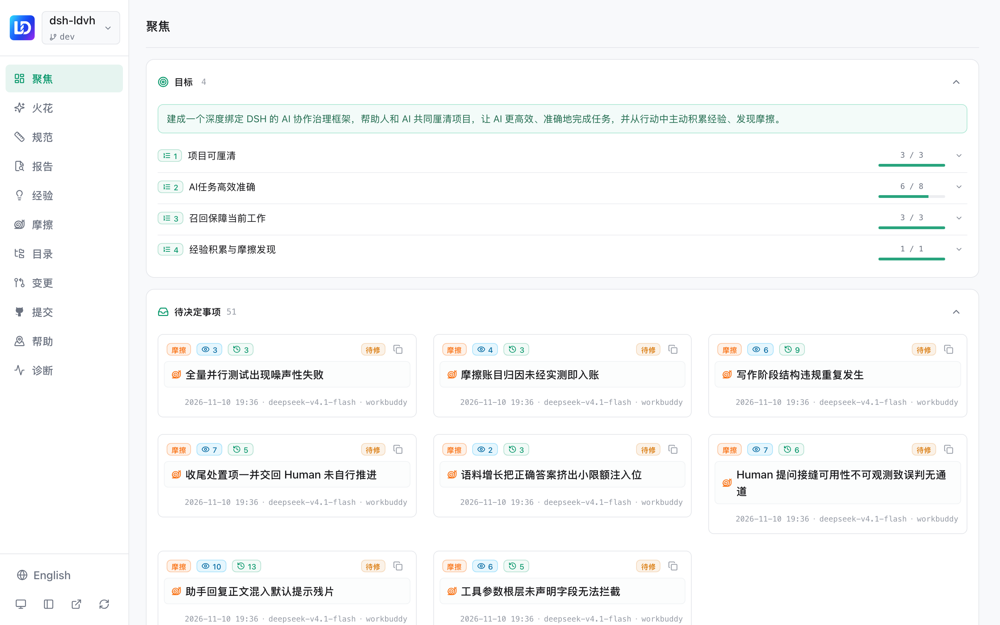

<p align="center">
  
</p>

<p align="center">
  
</p>

<h1 align="center">LDVH · LD Vibe Harness</h1>

<p align="center"><b>一个深度绑定 DSH 的 AI 协作与治理框架，核心价值是对齐 Vibe、协调 Coding。<br>让人与 AI 对项目形成一致认识，让项目进展更稳定、执行更顺利。</b></p>

<p align="center">
  <a href="plugin/README.en.md">English（插件页）</a> ·
  <a href="#截图">截图</a> ·
  <a href="#这是什么">这是什么</a> ·
  <a href="#快速开始开发">快速开始（开发）</a> ·
  <a href="#版本号双轨">版本</a> ·
  <a href="plugin/CHANGELOG.md">更新日志</a> ·
  <a href="https://github.com/dingminhua/dsh-ldvh/issues">问题反馈</a>
</p>

<p align="center">
  <a href="https://www.npmjs.com/package/dsh-ldvh"></a>
  <a href="https://www.npmjs.com/package/dsh-ldvh"></a>
  <a href="https://github.com/dingminhua/dsh-ldvh/actions/workflows/ci.yml"></a>
  <a href="LICENSE"></a>
  <a href="https://github.com/dingminhua/dsh-ldvh/stargazers"></a>
  <a href="https://dshfind.com/plugins/dingminhua/dsh-ldvh"></a>
</p>

> 版本 `1.0.4` ｜ MIT License（与 DSH 本体同协议）
> 版本 `1.0.4` 的发布树：与开发线（`dev` 分支）结构一致，不含项目专属事实源目录。

## 截图

### 设置页 · 服务与入口 / 代理辅助 / 召回预算

<p align="center">
  
</p>

### 设置页 · 把关请示

<p align="center">
  
</p>

### 设置页 · 管辖项目（路径已脱敏）

<p align="center">
  
</p>

## 这是什么

LDVH（LD Vibe Harness）以 **DSH 原生插件为统一交付形态**。人与 AI 协作有一组反复出现的困难——AI 的输出靠概率推理、人难以长期维持规划与记忆、双方的不确定会互相放大。LDVH 的机制逐条对着这些困难（Web 帮助页「这是什么」有更详细的展开）：

| 短板 | 典型表现 | 对应机制 |
|---|---|---|
| AI 的输出不稳 | 上下文缺失或过载时容易猜错、采信冲突信息，且难以跨会话保留认识 | 规范源给边界、事实源给依据、动作有校验 |
| 人接不住也留不住 | 长期规划越做越模糊，想法与已作的决定随对话散掉 | 每样东西都有可回读的对象，打开看得见、回来接得上 |
| 双方互相放大误差 | AI 不会主动停在困惑处，人难以接住它的笃定、它也猜不准人的含糊 | 该由 Human 决定的必须请示；依据不足时停止而非硬答 |

**核心价值是「对齐 Vibe、协调 Coding」**（`specs/00` §1）：对齐 Vibe 是对**认识**的要求——人与 AI 对项目的由来、现状、去向形成一致；协调 Coding 是对**执行**的要求——借宿主调度把权责、火花、规范、报告、经验、摩擦落到可回读的载体上。

七项业务系统承载业务过程（`specs/00` §2.6）：

| 核心价值 | 承接的业务系统 |
|---|---|
| 对齐 Vibe | 目标规划、火花记录、双源召回 |
| 协调 Coding | 把关请示、调研吸收、经验积累、摩擦销账 |

这些能力通过四种价值交付装进 DSH：**AI 工作引导、LDVH CLI 确定性执行、Web 信息呈现、Git 机械守护**（`specs/00` §2.8）。规则由规范源承载（元规范 `specs/` 与项目事实规范 `ldvh-base/norms/`），判断由事实源锚定（七类事实对象）；每次行动前从两源召回，以对话发起的行动由单一主控 AI 最终负责，以主控自查与机械校验为必守底线，代理审核在强制门禁范围内必做、其余按风险与请示结果安排。

**规范定义 ≠ 已落地能力**：以上是机制设计，插件已实现的能力以 [`plugin/README.md`](plugin/README.md) 为准；Web 帮助页（`/ldvh/help`）按对象、系统、入口分章，可作为快速导览；权威表述仍以 [`specs/`](specs/) 与事实源为准。

## 仓库结构

本树为 1.0.4 发布树，只含发布所需内容（见下表）。项目专属事实源（`ldvh-base/`）与开发期文档（`docs/`、`DEVELOPMENT.md`、`RELEASING.md`）不在发布树内，其完整内容在 `dev` 分支。

| 路径 | 内容 |
|---|---|
| `specs/` | 规范源（LDVH 自身的元规范：根规范、模型规范、业务系统规范、事实类型规范、附件） |
| `plugin/` | DSH 原生插件（Host 侧实现、客户端设置面与会话视图、LDVH Web SPA、测试） |
| `icons/` | 插件图标（多尺寸） |
| `plugin/docs/assets/` | 发布用截图（设置页三屏、LDVH Web、DSH 内面板） |
| `LICENSE` | MIT 协议 |

## 快速开始（开发）

```bash
# 安装插件到本机 desktop profile（link: 方式，不复制文件）
dsh plugin --profile desktop add /absolute/path/to/dsh-ldvh/plugin

# 日常验证
npm --prefix plugin ci
npm --prefix plugin test
cd plugin && npm pack --dry-run
```

安装或修改 Host / Client / bundle patch 后需要重启 DSH Desktop（这些部分在进程启动时加载）。目标宿主基线见 `plugin/README.md` 的「宿主兼容」。

## 版本号双轨

对外发布版本与开发迭代版本分离，二者共享主版本、互不污染：

| 轨 | 语法 | 递增时机 | 当前 |
|---|---|---|---|
| 对外发布版本 | `MAJOR.MINOR.PATCH` | 仅正式发布时 | `1.0.4` |
| 开发迭代版本 | 同主版本 + `-dev.N` | 发布后进入下一轮 | 见 `dev` 分支 |

发布封存干净版本后，开发线在 `dev` 分支进入下一轮。

## 当前里程碑

1. ✅ **规范体系**：根规范与模型规范、业务系统规范、七类事实类型规范已建立并进入当前规则源
2. ✅ **事实源运行**：Goal / SubGoal / Spark / Norm / Report / Pitfall / Friction 七类对象已在本项目运行
3. ✅ **插件落地**：管辖项目管理、Git Gate、设置页一节、LDVH Web 与会话视图、`ldvh_*` 工具面与规则引导注入均已落地
4. ✅ **发布准备**：市场门面（README / 截图 / 版本声明点）与发布门禁已完成
5. ✅ **版本发布**：`1.0.0` 首次正式发布已封存；`1.0.4` 补丁版改后端编译产物直跑、去 tsx/esbuild 安装摩擦

## 延伸阅读

- 根规范（LDVH 为什么存在、解决方案与构成、Human 的权利与 AI 的责任）：[`specs/00-理念与构成.md`](specs/00-理念与构成.md)
- 插件市场页（安装、使用、配置项、宿主兼容）：[`plugin/README.md`](plugin/README.md)

## License

MIT © LaoDing
