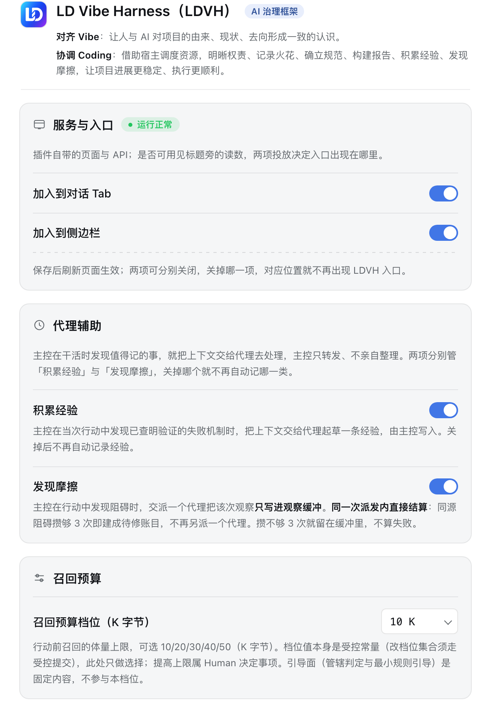
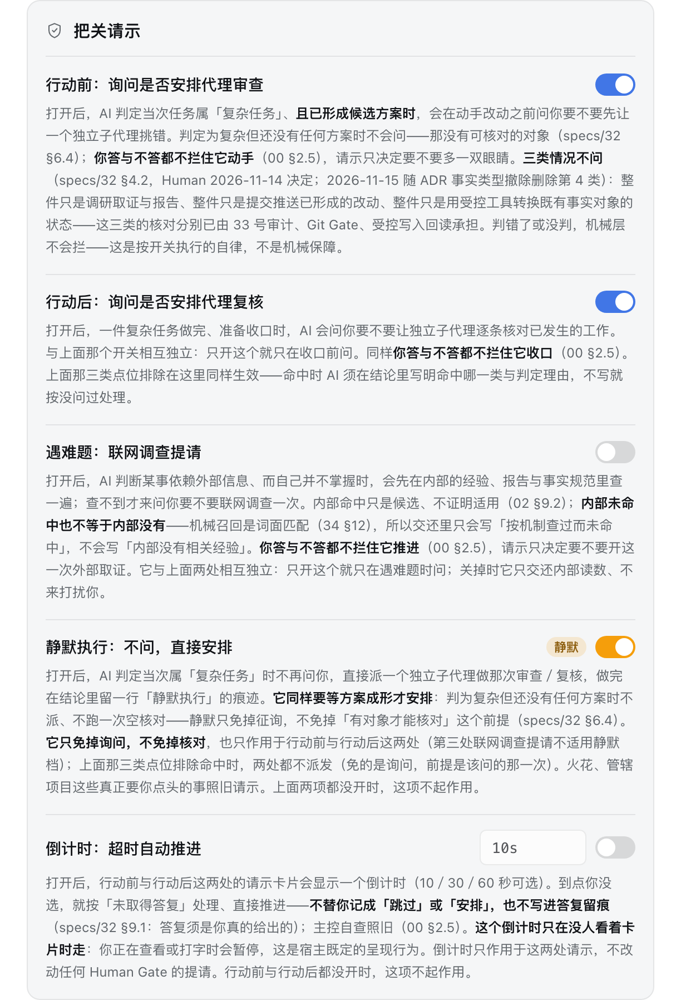
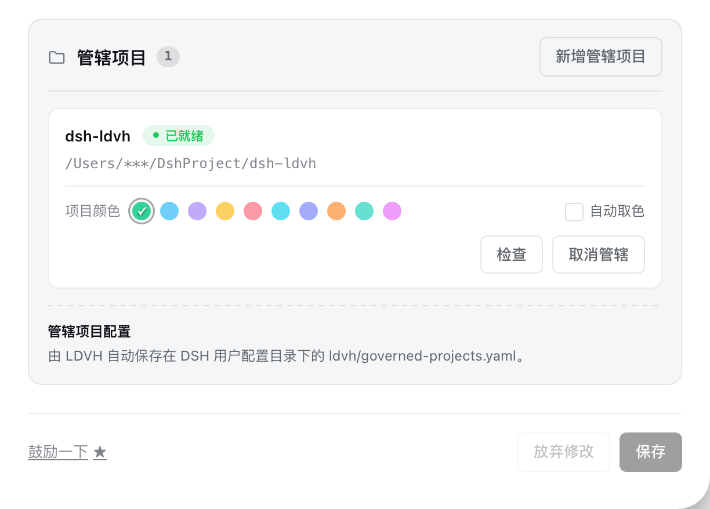
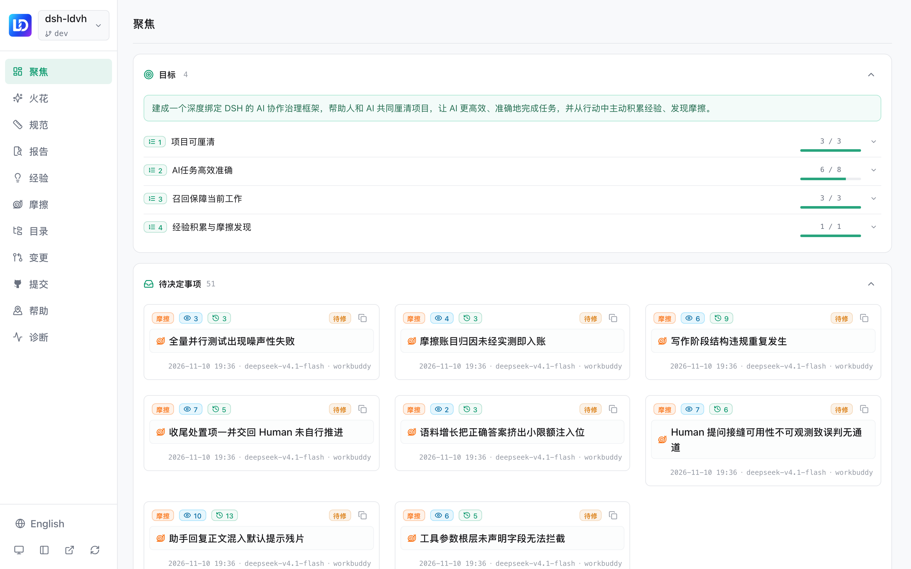
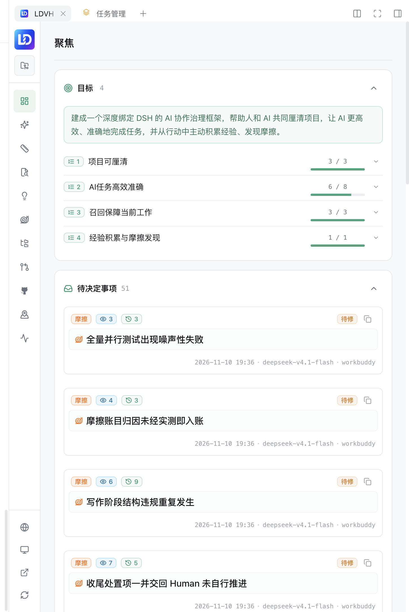

# dsh-ldvh

English | [简体中文](README.md)

> Version `1.0.0-dev.1` (development preview) · MIT License · for DSH Desktop `0.2.2-rc.5`
> **Development preview**: no release version has been published yet and the release gate is still being closed, so installation by ordinary users is not recommended yet.

**LD Vibe Harness (LDVH)** is the native DeepSeek Harness plugin: it brings "specifications + facts + mechanical guarding" into DSH, so the human and the AI share an understanding of where the project came from, where it stands, and where it is going (align Vibe), and so the project advances more steadily and execution goes more smoothly (coordinate Coding).

| Settings 1/3: service & entries · proxy assistance · recall budget | Settings 2/3: consult requests |
|---|---|
|  |  |

| Settings 3/3: governed projects (path redacted) | LDVH Web presentation |
|---|---|
|  |  |



## Capabilities

- **Governed projects** — register a Git repository as a governed project; installation writes the registration, initialises the `ldvh-base/` fact-source directories, and installs the Git hooks.
- **Git Gate** — two managed hooks (`commit-msg` validates controlled-commit messages, `pre-commit` runs the shared checks); non-conforming commits are blocked.
- **LDVH Web** — presentation of the project's facts: focus (goals and pending decisions), sparks, norms, reports, experience, friction, catalogue, changes, commits, help and diagnostics.
- **LDVH conversation view** — view the LDVH view of the current session as a tab inside DSH.
- **`ldvh_*` tool surface** — deterministic services for the AI: governance scope resolution and registration, specification reading, controlled fact-object writes and reads, commit pre-checks, research sessions and the online-research consult — 36 of them are callable from the main session (one more is registered on the subagent surface only).
- **AI work guidance** — rules guidance and the minimal rule set are injected per session (including the pre-action dual-source recall candidates), so action boundaries, the way facts are written and the hand-back obligations are present in the session.

## Installation

### Plugin marketplace

Available once a release version is published:

```bash
dsh plugin add dsh-ldvh
```

### Local source install (development and trials)

```bash
dsh plugin --profile desktop add /absolute/path/to/dsh-ldvh/plugin
```

Restart **DSH Desktop** after installing or changing Host / Client / bundle-patch code — those parts are loaded at process start.

### npm package

Available once a release version is published:

```bash
npm install -g dsh-ldvh
dsh plugin add dsh-ldvh
```

The npm package also ships a command-line entry point for scripted management of governed projects and hooks:

```bash
dsh-ldvh governed-project <list|inspect|install|uninstall-hook|register|unregister> [--project ABSOLUTE_GIT_ROOT] [--id PROJECT_ID] [--human-confirmed]
```

## Usage

1. **Register a governed project** — in `Settings → LDVH → Governed project configuration`, enter the project ID (unique, immutable after creation) and the Git root, then press "Install". The fact source and the Git Gate are enabled for that project afterwards.
2. **Open the presentation** — through the LDVH entry in the sidebar or the conversation tab (each can be switched on or off separately), or in a browser at `http://<dsh-host>/ldvh`.
3. **Work inside DSH** — the AI reads and writes specifications and facts through the `ldvh_*` tools; controlled commits are guarded by the Git Gate.

## Configuration

The `Settings → LDVH` section has four groups:

| Group | Items |
|---|---|
| Service and entries | Web presentation status reading, add to conversation tab, add to sidebar |
| Proxy assistance | Accumulate experience, discover friction (switching one off stops recording that category automatically) |
| Recall budget | Size cap of the pre-action recall (10/20/30/40/50 K bytes) |
| Consult requests | Before acting: ask whether to arrange a proxy audit; after working: ask whether to arrange a proxy review; silent execution: do not ask, arrange directly; when stuck: ask about online research; countdown seconds for the consult cards |

The "Governed project configuration" group adds: new governed project, check, repair, ungovern, project ID, Git root, project colour.

Two master switches (Web presentation, proxy assistance) can currently only be changed in the plugin configuration file; the settings section deliberately no longer offers them, to avoid two places overriding each other.

## Host compatibility

| Item | Value |
|---|---|
| Host | DSH Desktop `0.2.2-rc.5` (development target baseline) |
| Supported range | `@deepseek-ai/dsh >= 0.1.7-rc.1 < 0.3.0` |
| Node.js | `>=22.15.0` (the host itself requires `^22.19.0 \|\| >=24.0.0`) |

Platform verification status (implementation and acceptance are recorded separately):

| Platform | Implementation | Real-machine acceptance |
|---|---|---|
| macOS | Complete | The `/ldvh` route and `/ldvh/api/health` passed on `0.2.2-rc.5`; the 10 governed-project lifecycle items are recorded in the repository's verification record `docs/governed-project-lifecycle-verification.md` (a verification record, not a specification or fact source; it does not state the host version or the date) |
| Windows | Complete | The 10 governed-project lifecycle items + permission criteria (real-machine run on 2026-11-10); UNC / junction, NTFS occupancy races and constructed ACL-unreadable scenarios are **not covered** |
| Linux | Runs against the same host contract | CI coverage only, not accepted |

## Known limitations

- No release version has been published; `1.0.0-dev.1` is a development preview.
- The uncovered Windows scenarios are listed above — they must not be read as "Windows fully accepted"; the code has changed since the 2026-11-10 run and that conclusion has not been re-verified against the current code.
- Linux is outside the support declaration (CI coverage only).
- The CHANGELOG entries of the plugin package are still placeholders and must be written from the actually committed changes before publishing.
- Test baseline: a run of `npm --prefix plugin test` on the current working tree reported no failures (0 failed; 19 skipped, within the registered skip baseline of 27). The skipped cases still have to be checked one by one — the release gate does not accept skips in place of a passing result.

## License

MIT © LaoDing
