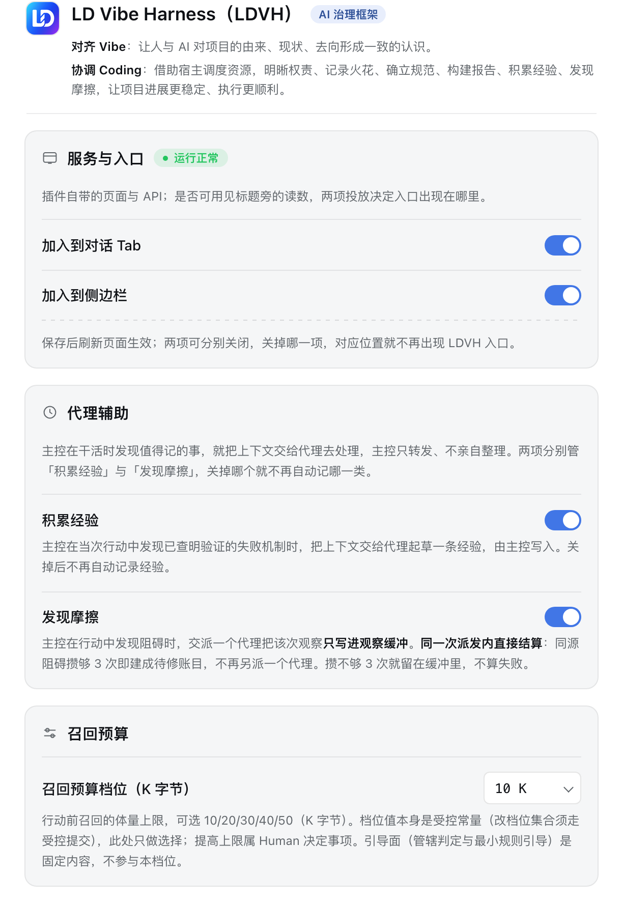
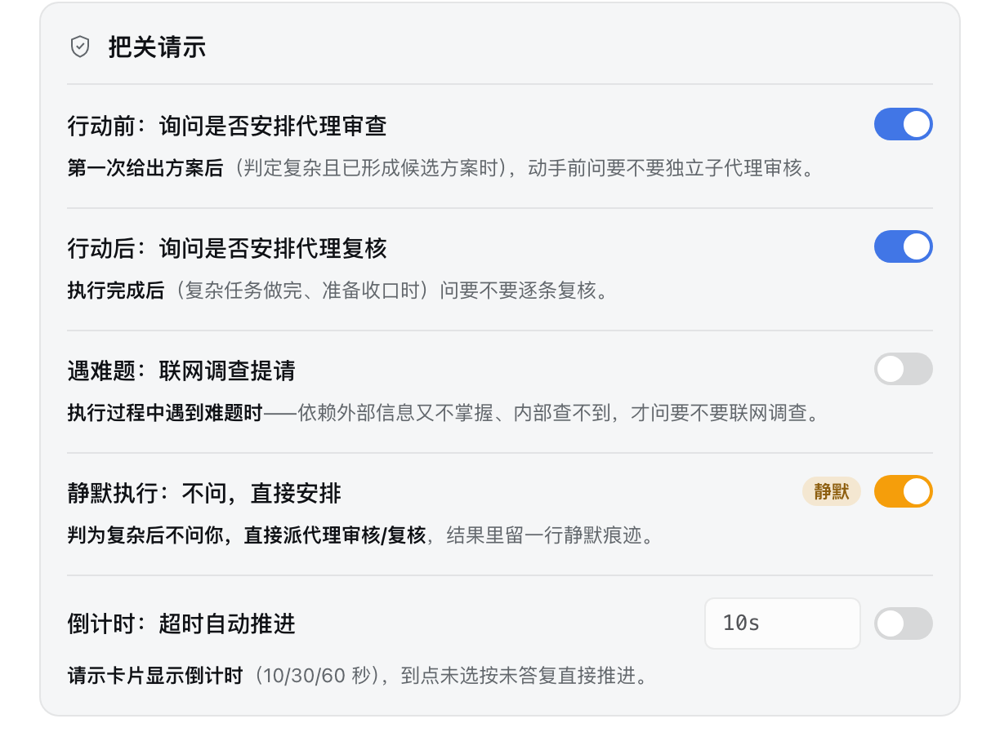
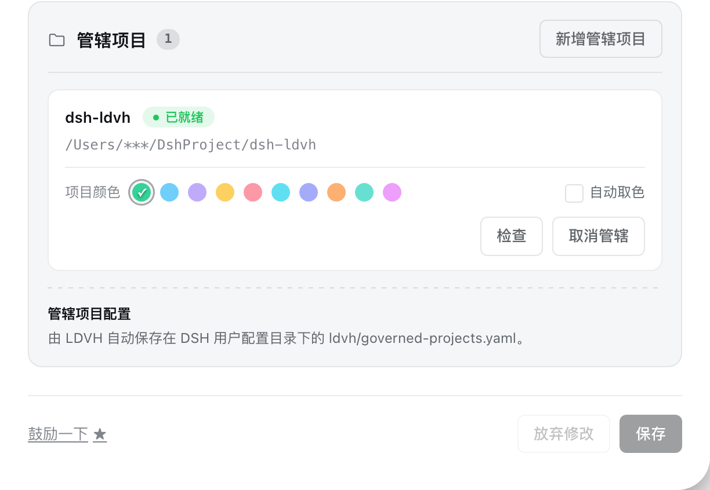
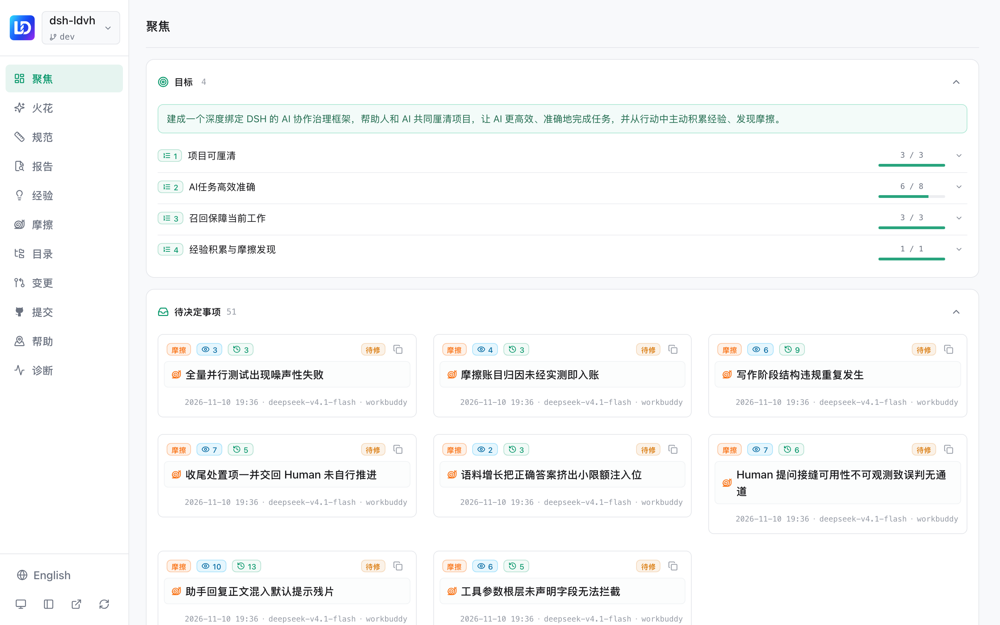
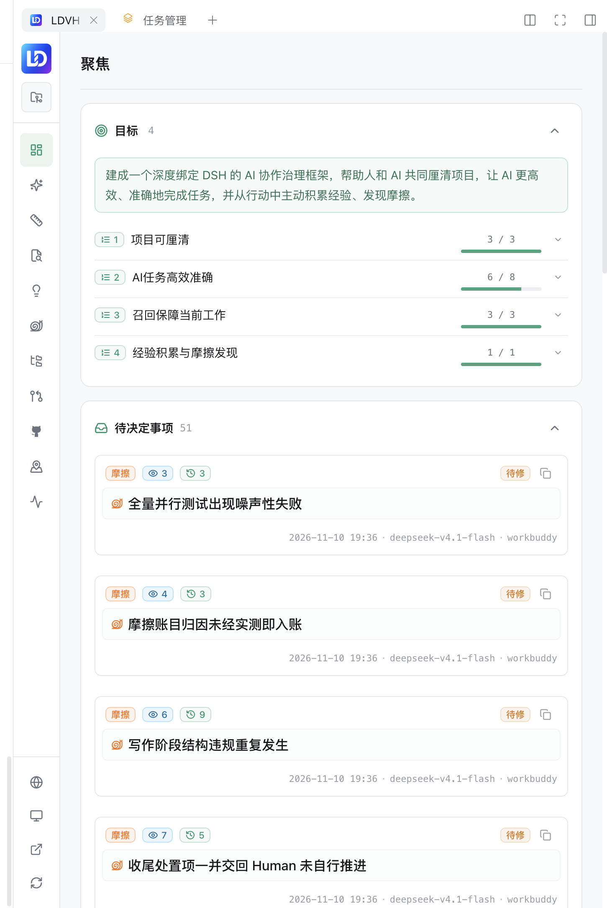

# dsh-ldvh

[English](README.en.md) | 简体中文

> 版本 `1.0.0-dev.1`（开发预览）· MIT License · 面向 DSH Desktop `0.2.2-rc.5`
> **当前为开发预览**：插件尚未发布正式版本，发布门禁仍在收口，暂不建议普通用户安装。

**LD Vibe Harness（LDVH）** 是 DeepSeek Harness 的原生插件：把「规范 + 事实 + 机械守护」装进 DSH，让 Human 与 AI 对项目的由来、现状、去向形成一致的认识（对齐 Vibe），并让项目进展更稳定、执行更顺利（协调 Coding）。

| 设置页 1/3：服务与入口 · 代理辅助 · 召回预算 | 设置页 2/3：把关请示 |
|---|---|
|  |  |

| 设置页 3/3：管辖项目（路径已脱敏） | LDVH Web 信息呈现 |
|---|---|
|  |  |



## 能力

- **管辖项目**——把一个 Git 仓库登记为受管辖项目；安装即完成登记、初始化 `ldvh-base/` 事实源目录与安装 Git Hook。
- **Git Gate**——两枚受管 Hook（`commit-msg` 校验受控提交信息、`pre-commit` 跑共享检查），不合规即阻断。
- **LDVH Web**——项目事实的信息呈现：聚焦（目标与待决定事项）、火花、规范、报告、经验、摩擦、目录、变更、提交、帮助与诊断。
- **LDVH 会话视图**——在 DSH 对话中以 Tab 形式查看本会话的 LDVH 视图。
- **`ldvh_*` 工具面**——面向 AI 的确定性服务：管辖判定与登记、规范读取、事实对象受控读写、提交预检、调研会话与联网调查提请等，主控会话可调用 36 个（另有 1 个仅在子代理面注册）。
- **AI 工作引导**——按会话注入规则引导与最小规则集（含行动前的双源召回候选），让 AI 的行动边界、事实读写方式与交还义务在会话中在场。

## 安装

### 插件市场

正式版本发布后可用：

```bash
dsh plugin add dsh-ldvh
```

### 本地源码安装（开发与试用）

```bash
dsh plugin --profile desktop add /absolute/path/to/dsh-ldvh/plugin
```

安装或修改 Host / Client / bundle patch 后需要**重启 DSH Desktop**（这些部分在进程启动时加载）。

### npm 包

正式版本发布后可用：

```bash
npm install -g dsh-ldvh
dsh plugin add dsh-ldvh
```

npm 包另带一个命令行入口，供脚本化操作管辖项目与 Hook：

```bash
dsh-ldvh governed-project <list|inspect|install|uninstall-hook|register|unregister> [--project ABSOLUTE_GIT_ROOT] [--id PROJECT_ID] [--human-confirmed]
```

## 使用

1. **登记管辖项目**——在 `设置 → LDVH → 管辖项目配置` 中填写项目 ID（唯一、创建后不可修改）与 Git 根目录，点「安装」。安装后该项目即启用事实源与 Git Gate。
2. **打开信息呈现**——侧边栏或对话 Tab 中的 LDVH 入口（可分别开关），或在浏览器打开 `http://<dsh-host>/ldvh`。
3. **在 DSH 里干活**——AI 会通过 `ldvh_*` 工具读写规范与事实；受控提交由 Git Gate 把关。

## 配置项

`设置 → LDVH` 一节包含四组：

| 组 | 项 |
|---|---|
| 服务与入口 | Web 呈现状态读数、加入到对话 Tab、加入到侧边栏 |
| 代理辅助 | 积累经验、发现摩擦（关闭后不再自动记录对应的一类） |
| 召回预算 | 行动前召回的体量上限（10/20/30/40/50 K 字节） |
| 把关请示 | 行动前：询问是否安排代理审查；行动后：询问是否安排代理复核；静默执行：不问，直接安排；遇难题：联网调查提请；请示倒计时秒数 |

另有「管辖项目配置」组：新增管辖项目、检查、更新修复、取消管辖、项目 ID、Git 根目录、项目颜色。

部分总开关（Web 呈现、代理辅助）当前只能在插件配置文件中调整，设置面不再提供——这是有意为之，避免两处开关互相覆盖。

## 宿主兼容

| 项 | 值 |
|---|---|
| 宿主 | DSH Desktop `0.2.2-rc.5`（开发目标基线） |
| 兼容区间 | `@deepseek-ai/dsh >= 0.1.7-rc.1 < 0.3.0` |
| Node.js | `>=22.15.0`（宿主自身要求 `^22.19.0 \|\| >=24.0.0`） |

平台验证状态（实现与验收分开登记）：

| 平台 | 实现 | 真机验收 |
|---|---|---|
| macOS | 完整 | `/ldvh` 路由与 `/ldvh/api/health` 于 `0.2.2-rc.5` 实测通过；管辖项目生命周期 10 项见仓库验证记录 `docs/governed-project-lifecycle-verification.md`（该记录是验证记录，不是规范源与事实源；未载宿主版本与日期） |
| Windows | 完整 | 管辖项目生命周期 10 项 + 权限判据（2026-11-10 真机实测）；UNC / junction、NTFS 占用竞争、ACL 读不到的构造场景**未覆盖** |
| Linux | 同一宿主契约下运行 | 仅 CI 覆盖，未验收 |

## 已知限制

- 尚未发布正式版本；`1.0.0-dev.1` 为开发预览。
- Windows 上未覆盖的场景如上表所列，不得据此认为 Windows 已完整验收通过；2026-11-10 的验收结论此后代码有变动，未在当前代码上重验。
- Linux 不在支持声明内（仅 CI 覆盖）。
- 测试基线：本次在当前工作树实测 `npm --prefix plugin test` 无失败项（0 失败；19 条跳过，在登记基线 27 以内）。跳过项仍须逐项核对——发布门禁不接受以跳过替代通过结论。

## License

MIT © LaoDing
